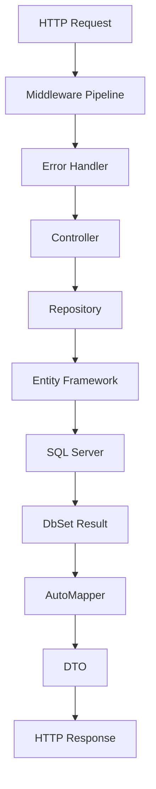

# Architecture

_Generated by Forge from `main` at `8a6ac81`._

Perfect! Now I have enough information to write the Architecture page. Let me create the documentation:

---

ShopBridge follows a clean, layered architecture pattern built on ASP.NET Core with Entity Framework Core. The application separates concerns into distinct layers—controllers, repositories, DTOs, and data access—connected through dependency injection. This design promotes testability, maintainability, and clear separation of responsibilities.

## Layered Architecture Overview

The application is organized into four primary layers:

| Layer | Purpose | Location |
|-------|---------|----------|
| **Presentation** | HTTP request handling and routing | `ShopBridge/Controllers/` |
| **Application** | Business logic and data transformation | `ShopBridge/Repositories/` |
| **Data Transfer** | Request/response serialization | `ShopBridge/DTO/` |
| **Data Access** | Database context and Entity Framework | `ShopBridge/InventoryDBContext.cs` |

## Dependency Injection

The application uses ASP.NET Core's built-in dependency injection container configured in `ShopBridge/Startup.cs`. Key registrations include:

- **AutoMapper**: Registered with `AddAutoMapper()` to scan all assemblies for mapping profiles
- **Repository Pattern**: `IInventoryRepository` is registered as scoped, ensuring a new instance per HTTP request
- **Database Context**: `InventoryDBContext` is configured with SQL Server connection string from `appsettings.json`

```csharp
services.AddAutoMapper(AppDomain.CurrentDomain.GetAssemblies());
services.AddScoped<IInventoryRepository, InventoryRepository>();
services.AddDbContext<InventoryDBContext>(options => 
    options.UseSqlServer(Configuration.GetConnectionString("DefaultConnection")));
```

## Controllers Layer

Controllers in `ShopBridge/Controllers/` handle HTTP requests and delegate business logic to repositories. They are responsible for:

- Receiving and validating HTTP requests
- Calling repository methods
- Returning appropriate HTTP responses
- Mapping domain models to DTOs

## Repository Pattern

The repository layer (`ShopBridge/Repositories/`) abstracts data access logic behind interfaces. This enables:

- Loose coupling between controllers and data access
- Easy unit testing through mock repositories
- Centralized query logic

The `IInventoryRepository` interface defines the contract, while `InventoryRepository` implements concrete data access operations using Entity Framework Core.

## Data Transfer Objects (DTOs)

DTOs in `ShopBridge/DTO/` define the shape of data sent to and received from API clients. They decouple the API contract from internal domain models, allowing the database schema to evolve independently of the API surface.

## Database Context

`ShopBridge/InventoryDBContext.cs` extends `DbContext` and manages the connection to SQL Server. It exposes `DbSet<Inventory>` for querying and persisting inventory records. The context is configured via Entity Framework Core migrations in `ShopBridge/Migrations/`.

## Middleware Pipeline

The application configures a middleware pipeline in `ShopBridge/Startup.cs` that processes all HTTP requests:

1. **Error Handler Middleware** (`ShopBridge/Middlewares/ErrorHandlerMiddleware.cs`) — Catches and formats exceptions globally
2. **HTTPS Redirection** — Enforces secure connections
3. **Routing** — Maps requests to controllers
4. **Authorization** — Applies security policies
5. **Swagger UI** — Serves interactive API documentation

## Application Flow



## Configuration

Application settings are stored in `appsettings.json` and `appsettings.Development.json`. The connection string for SQL Server is retrieved at startup:

```csharp
Configuration.GetConnectionString("DefaultConnection")
```

This allows environment-specific configuration without code changes.

## Sources
- `ShopBridge/Startup.cs`
- `ShopBridge/Program.cs`
- `ShopBridge/InventoryDBContext.cs`
