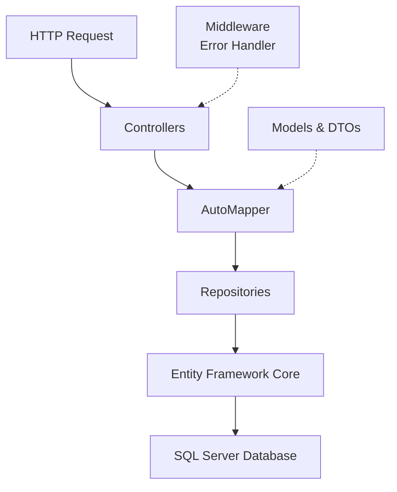

# Architecture

_Generated by Forge from `main` at `8a6ac81`._

ShopBridge follows a **layered architecture** pattern built on ASP.NET Core, separating concerns across Controllers, Repositories, DTOs, Models, and middleware components. This design promotes maintainability, testability, and clear separation of responsibilities. The application uses Entity Framework Core for data access and AutoMapper for object mapping between domain models and DTOs.

## Layered Architecture Overview

The application is organized into distinct layers, each with specific responsibilities:



## Core Layers

### Controllers Layer
Controllers (`ShopBridge/Controllers/`) handle incoming HTTP requests and orchestrate the business logic flow. They receive requests, invoke repository methods, and return responses to clients. The `InventoryController` manages all inventory-related endpoints.

### Repository Layer
Repositories (`ShopBridge/Repositories/`) abstract data access logic and provide a clean interface for the Controllers. The `IRepository` interface defines the contract, while `InventoryRepository` implements concrete data operations using Entity Framework Core. This layer isolates database queries from business logic.

### Data Transfer Objects (DTOs)
DTOs (`ShopBridge/DTO/`) define the shape of data exchanged between the API and clients. `InventoryDto` maps domain models to API responses, allowing the API contract to remain independent of internal model changes.

### Models
Models (`ShopBridge/Models/`) represent domain entities and are mapped to database tables via Entity Framework Core. They define the core business entities of the application.

## Dependency Injection & Configuration

The `Startup.cs` file configures the application's dependency injection container:

```csharp
services.AddAutoMapper(AppDomain.CurrentDomain.GetAssemblies());
services.AddScoped<IInventoryRepository, InventoryRepository>();
services.AddDbContext<InventoryDBContext>(options => 
    options.UseSqlServer(Configuration.GetConnectionString("DefaultConnection")));
```

- **AutoMapper** is registered to scan all assemblies for mapping profiles
- **Repositories** are registered as scoped services, creating a new instance per HTTP request
- **DbContext** is configured with SQL Server using the connection string from `appsettings.json`

## Middleware Pipeline

The middleware pipeline in `Startup.cs` processes requests in order:

| Middleware | Purpose |
|-----------|---------|
| `ErrorHandlerMiddleware` | Global error handling and exception transformation |
| `UseHttpsRedirection` | Enforces HTTPS for all requests |
| `UseRouting` | Matches requests to endpoints |
| `UseAuthorization` | Enforces authorization policies |
| `UseSwagger` / `UseSwaggerUI` | Serves API documentation |

The `ErrorHandlerMiddleware` (`ShopBridge/Middlewares/`) wraps the request pipeline to catch unhandled exceptions and return standardized error responses.

## Data Access

The `InventoryDBContext` (`ShopBridge/InventoryDBContext.cs`) extends `DbContext` and defines the database schema. Entity Framework Core migrations manage schema changes, stored in `ShopBridge/Migrations/`.

## Object Mapping

`AutoMapperProfile.cs` defines mapping configurations between domain models and DTOs, enabling automatic transformation of data as it flows through the layers.

## Request Flow

1. HTTP request arrives at a Controller action
2. Controller invokes Repository methods
3. Repository queries the database via Entity Framework Core
4. Results are mapped to DTOs using AutoMapper
5. Controller returns the DTO response
6. Middleware catches any exceptions and returns error responses

---

## Sources
- `ShopBridge/Program.cs`
- `ShopBridge/Startup.cs`
