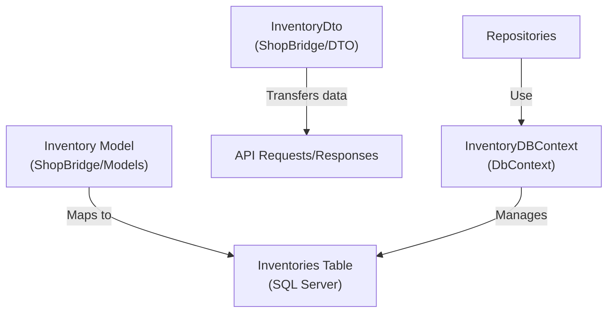

# Data Model

_Generated by Forge from `main` at `8a6ac81`._

Perfect! Now I have all the information I need to write the Data Model page. Let me create it:

---

ShopBridge uses Entity Framework Core to manage its database schema and models. The data model is centered around the `Inventory` entity, which represents products in the inventory system. The application uses SQL Server as its database provider and includes migrations to manage schema versioning.

## Core Entity

The `Inventory` model in `ShopBridge/Models/Inventory.cs` represents a product in the inventory system with the following properties:

| Property | Type | Constraints | Description |
|----------|------|-----------|-------------|
| `Id` | `int` | Primary Key, Auto-generated | Unique identifier for the inventory item |
| `Name` | `string` | Max 50 characters | Product name |
| `Description` | `string` | Max 150 characters | Product description |
| `Price` | `decimal` | Required | Product price with 18 digits and 2 decimal places |

The entity uses data annotations for validation and database constraints:

```csharp
[Key]
[DatabaseGenerated(DatabaseGeneratedOption.Identity)]
public int Id { get; set; }

[MaxLength(50)]
public string Name { get; set; }

[MaxLength(150)]
public string Description { get; set; }

public decimal Price { get; set; }
```

## Database Context

The `InventoryDBContext` class in `ShopBridge/InventoryDBContext.cs` inherits from `DbContext` and manages the database connection and entity mappings:

```csharp
public class InventoryDBContext : DbContext
{
    public InventoryDBContext(DbContextOptions<InventoryDBContext> options) 
        : base(options) { }

    public DbSet<Inventory> Inventories { get; set; }
}
```

The context exposes a `DbSet<Inventory>` property named `Inventories`, which maps to the `Inventories` table in the database. The `OnModelCreating` method is available for advanced configuration if needed.

## Data Transfer Object

The `InventoryDto` class in `ShopBridge/DTO/InventoryDto.cs` is used for API requests and responses:

```csharp
public class InventoryDto
{
    public int? Id { get; set; }
    [Required]
    public string Name { get; set; }
    [Required]
    public string Description { get; set; }
    [Required]
    public decimal? Price { get; set; }
}
```

The DTO mirrors the entity structure but uses nullable types for optional fields and includes `[Required]` attributes for validation. The `Id` field is nullable to support creation scenarios where the ID is generated by the database.

## Database Schema

The initial migration in `ShopBridge/Migrations/20210509141818_InitialCreate.cs` creates the `Inventories` table with the following schema:

| Column | Type | Constraints |
|--------|------|-----------|
| `Id` | `int` | Primary Key, Identity (1,1) |
| `Name` | `nvarchar(50)` | Nullable |
| `Description` | `nvarchar(150)` | Nullable |
| `Price` | `decimal(18,2)` | Not Null |

The table uses SQL Server's identity feature for auto-incrementing primary keys. String columns are stored as Unicode (`nvarchar`) with specified maximum lengths.

## Entity Framework Core Configuration

The application is configured to use Entity Framework Core with SQL Server. The database context is registered in the dependency injection container during application startup, allowing repositories and services to access the database through the context.



## Migrations

Entity Framework Core migrations track schema changes over time. The migration system allows you to:

- Create new migrations when the model changes: `dotnet ef migrations add MigrationName`
- Apply pending migrations to the database: `dotnet ef database update`
- Revert migrations if needed: `dotnet ef database update PreviousMigration`

The `InventoryDBContextModelSnapshot.cs` file maintains a snapshot of the current model state for comparison during migration generation.

## Sources
- `ShopBridge/Models/Inventory.cs`
- `ShopBridge/InventoryDBContext.cs`
- `ShopBridge/DTO/InventoryDto.cs`
- `ShopBridge/Migrations/20210509141818_InitialCreate.cs`
