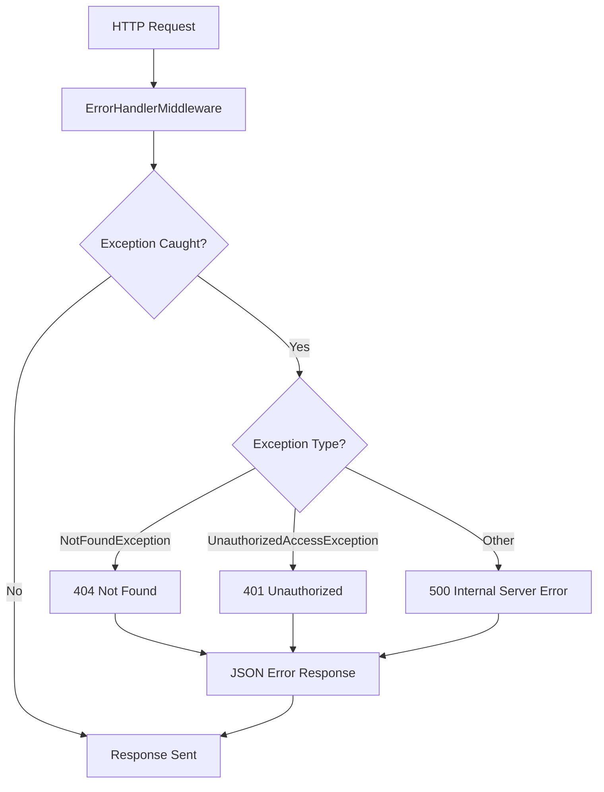

# Error Handling & Middleware

_Generated by Forge from `main` at `8a6ac81`._

ShopBridge implements a centralized error handling strategy through a global middleware component that intercepts exceptions across the entire application pipeline. This approach ensures consistent error responses, proper HTTP status codes, and a unified logging mechanism for all unhandled exceptions.

## Global Error Handler Middleware

The `ErrorHandlerMiddleware` class in `ShopBridge/Middlewares/ErrorHandlerMiddleware.cs` acts as the primary error handling layer. It wraps the entire request pipeline in a try-catch block, allowing all exceptions to be caught and processed uniformly before reaching the client.

The middleware is registered early in the HTTP pipeline within `ShopBridge/Startup.cs`:

```csharp
app.UseMiddleware<ErrorHandlerMiddleware>();
```

This placement ensures that all downstream middleware and endpoint handlers are protected by the error handler.

## Exception Handling Flow



## Custom Exception Types

ShopBridge defines a custom exception class `NotFoundException` in `ShopBridge/Middlewares/CustomerException.cs` for domain-specific error scenarios:

```csharp
public class NotFoundException: Exception
{
    public NotFoundException(string message) : base(message) { }
    
    public NotFoundException(string message, params object[] args)
        : base(String.Format(CultureInfo.CurrentCulture, message, args))
    {
    }
}
```

This exception supports formatted messages with parameters, enabling descriptive error messages throughout the application.

## Error Response Mapping

The middleware maps exceptions to appropriate HTTP status codes:

| Exception Type | HTTP Status | Description |
|---|---|---|
| `NotFoundException` | 404 | Resource not found |
| `UnauthorizedAccessException` | 401 | Authentication or authorization failure |
| Other exceptions | 500 | Unhandled server errors |

All error responses are serialized to JSON format with the following structure:

```json
{
  "message": "Error description"
}
```

## Response Configuration

The middleware sets the response content type to `application/json` before writing error details, ensuring clients receive properly formatted JSON responses regardless of the exception type.

## Development vs. Production

In development environments, the ASP.NET Core developer exception page is enabled via `app.UseDeveloperExceptionPage()` in `ShopBridge/Startup.cs`, providing detailed stack traces and diagnostic information. The global error handler provides a fallback for any exceptions not caught by the developer page.

## Integration Points

The error handling middleware integrates seamlessly with:

- **Repository layer**: Custom exceptions thrown from data access operations are caught and converted to appropriate HTTP responses
- **Service layer**: Business logic exceptions are propagated and handled uniformly
- **Controller actions**: Unhandled exceptions in endpoint handlers are intercepted before reaching the client

---

## Sources
- `ShopBridge/Middlewares/ErrorHandlerMiddleware.cs`
- `ShopBridge/Middlewares/CustomerException.cs`
- `ShopBridge/Startup.cs`
