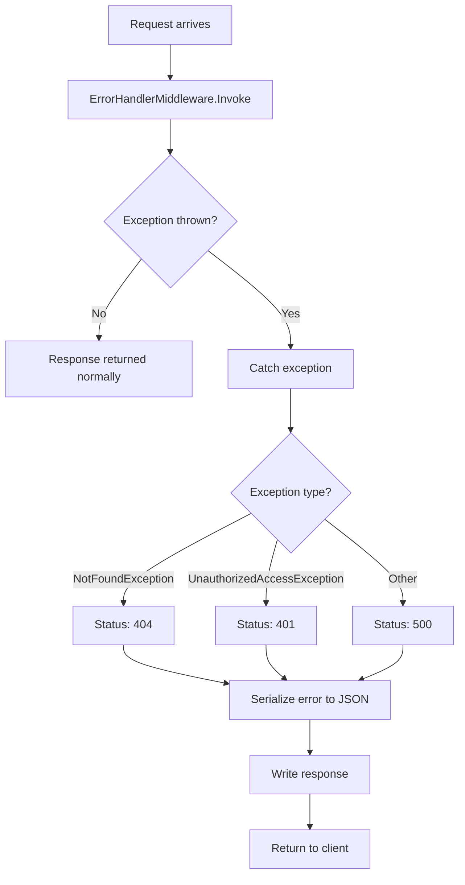

# Error Handling

_Generated by Forge from `main` at `8a6ac81`._

Now I have all the information I need. Let me write the Error Handling page:

---

ShopBridge implements a centralized error handling strategy through a global middleware component that intercepts exceptions across the application and returns consistent, standardized error responses. This approach ensures that all unhandled exceptions are caught, logged appropriately, and returned to clients with meaningful HTTP status codes and messages, improving API reliability and developer experience.

## Global Error Handler Middleware

The `ErrorHandlerMiddleware` class in `ShopBridge/Middlewares/ErrorHandlerMiddleware.cs` serves as the application's central exception handler. It wraps the entire request pipeline and catches any exceptions that occur during request processing.

**Key features:**
- Catches all unhandled exceptions in the request pipeline
- Maps exceptions to appropriate HTTP status codes
- Returns consistent JSON error responses
- Prevents sensitive error details from leaking to clients in production

The middleware is registered in `ShopBridge/Startup.cs` early in the pipeline:

```csharp
app.UseMiddleware<ErrorHandlerMiddleware>();
```

## Exception Mapping

The middleware implements a switch statement to map different exception types to HTTP status codes:

| Exception Type | HTTP Status Code | Description |
|---|---|---|
| `NotFoundException` | 404 Not Found | Resource does not exist |
| `UnauthorizedAccessException` | 401 Unauthorized | User lacks required authentication or permissions |
| Default (unhandled) | 500 Internal Server Error | Unexpected server-side error |

## Custom Exception Types

ShopBridge defines a custom `NotFoundException` in `ShopBridge/Middlewares/CustomerException.cs` for domain-specific error handling:

```csharp
public class NotFoundException: Exception
{
    public NotFoundException(string message) : base(message) { }
    public NotFoundException(string message, params object[] args)
        : base(String.Format(CultureInfo.CurrentCulture, message, args)) { }
}
```

This exception supports formatted messages with parameters, enabling descriptive error messages like `"Product with ID {0} not found"`.

## Error Response Format

All errors are returned as JSON with the following structure:

```json
{
  "message": "The requested resource was not found"
}
```

The response content type is always set to `application/json` for consistency.

## Middleware Execution Flow



## Development vs. Production

In development environments, ASP.NET Core's built-in `DeveloperExceptionPage` is enabled in `ShopBridge/Startup.cs`, providing detailed exception information:

```csharp
if (env.IsDevelopment())
{
    app.UseDeveloperExceptionPage();
}
```

The `ErrorHandlerMiddleware` is registered after this, ensuring development exceptions are visible during debugging while still providing fallback handling for production.

## Best Practices

- **Throw custom exceptions** from repositories and services when business logic fails (e.g., `NotFoundException` when a product is not found)
- **Include descriptive messages** in exceptions to help clients understand what went wrong
- **Use appropriate exception types** to ensure correct HTTP status codes are returned
- **Avoid exposing internal details** in error messages; the middleware automatically serializes only the message property

---

## Sources
- `ShopBridge/Middlewares/ErrorHandlerMiddleware.cs`
- `ShopBridge/Middlewares/CustomerException.cs`
- `ShopBridge/Startup.cs`
- `ShopBridge/Program.cs`
