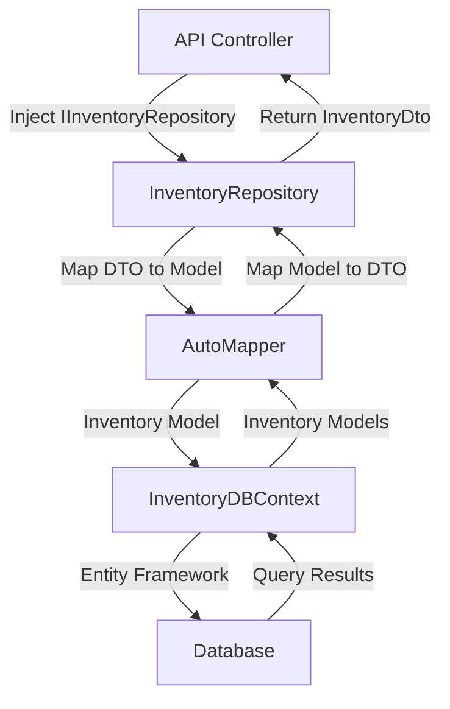

# Repositories & Services

_Generated by Forge from `main` at `8a6ac81`._

ShopBridge implements the repository pattern to provide a clean abstraction layer for data access operations. The repository pattern decouples business logic from database access, making the application more testable and maintainable. All inventory operations flow through the `IInventoryRepository` interface, which is injected into controllers and services. Data transfer objects (DTOs) are automatically mapped to domain models using AutoMapper, ensuring separation between API contracts and internal representations.

## Repository Pattern Overview

The repository pattern in ShopBridge follows a standard implementation with:

- **Interface-based design**: `IInventoryRepository` defines the contract for all data operations
- **Dependency injection**: Repositories are injected into controllers via the DI container
- **Async/await**: All database operations are asynchronous for better scalability
- **DTO mapping**: AutoMapper handles conversion between DTOs and domain models

## IInventoryRepository Interface

The `ShopBridge/Repositories/IRepository.cs` file defines the core data access contract:

```csharp
public interface IInventoryRepository
{
    Task<int> Add(InventoryDto inventory);
    Task<int> Delete(int id);
    Task<int> Edit(InventoryDto inventory);
    Task<IEnumerable<InventoryDto>> GetAll();
}
```

Each method returns the number of affected rows (`int`) or a collection of DTOs, allowing callers to verify operation success.

## InventoryRepository Implementation

The `ShopBridge/Repositories/InventoryRepository.cs` class implements the repository interface with the following responsibilities:

| Method | Purpose |
|--------|---------|
| `Add()` | Maps DTO to model, adds to context, saves changes |
| `Delete()` | Finds item by ID, removes it, throws `NotFoundException` if not found |
| `Edit()` | Finds item by ID, maps updated DTO, marks as modified, saves changes |
| `GetAll()` | Retrieves all inventory items, maps to DTOs |

### Key Implementation Details

**Dependency Injection:**
```csharp
public InventoryRepository(InventoryDBContext _inventoryDBContext, IMapper _mapper)
{
    inventoryDBContext = _inventoryDBContext;
    mapper = _mapper;
}
```

The repository receives `InventoryDBContext` (Entity Framework context) and `IMapper` (AutoMapper instance) through constructor injection.

**Error Handling:**
The `Delete()` and `Edit()` methods throw `NotFoundException` from `ShopBridge.Middlewares` when an inventory item cannot be found, enabling consistent error responses across the API.

**Async Operations:**
All methods use `async/await` with Entity Framework's async methods (`AddAsync()`, `FindAsync()`, `SaveChangesAsync()`), preventing thread pool starvation under load.

## AutoMapper Configuration

The `ShopBridge/AutoMapperProfile.cs` file configures object mapping:

```csharp
public class AutoMapperProfile : Profile
{
    public AutoMapperProfile()
    {
        CreateMap<Inventory, InventoryDto>().ReverseMap();
    }
}
```

The `ReverseMap()` call enables bidirectional mapping, allowing conversion from `Inventory` models to `InventoryDto` and vice versa. This is used throughout the repository to transform DTOs received from the API into domain models for database operations.

## Data Flow Diagram



## Integration with Dependency Injection

Repositories are registered in the application's service collection during startup, typically in `Startup.cs` or `Program.cs`. The DI container manages the lifecycle and injects dependencies automatically:

```csharp
services.AddScoped<IInventoryRepository, InventoryRepository>();
services.AddAutoMapper(typeof(AutoMapperProfile));
```

This ensures a single repository instance per HTTP request, maintaining consistency while allowing proper cleanup.

## Sources
- `ShopBridge/AutoMapperProfile.cs`
- `ShopBridge/Repositories/IRepository.cs`
- `ShopBridge/Repositories/InventoryRepository.cs`
