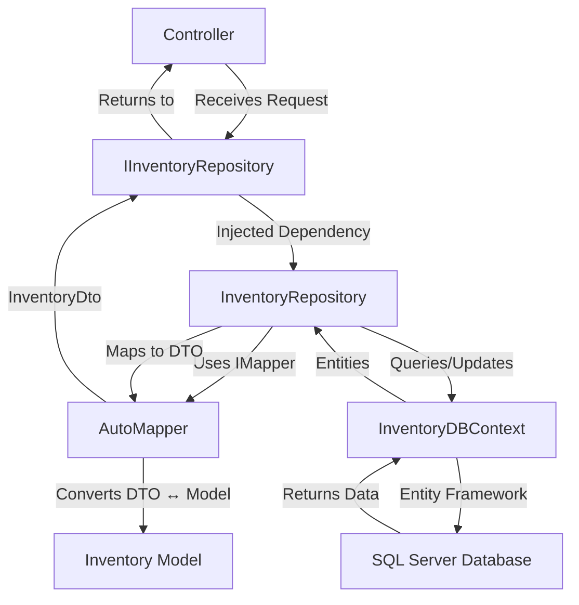

# Repositories and Services

_Generated by Forge from `main` at `8a6ac81`._

Perfect! Now I have all the information I need. Let me write the "Repositories and Services" page:

---

ShopBridge implements the repository pattern to abstract data access logic and uses dependency injection for loose coupling between layers. This design enables testability, maintainability, and separation of concerns by centralizing database operations in dedicated repository classes.

## Repository Pattern

The repository pattern provides a clean abstraction over data access operations. Each repository encapsulates CRUD operations for a specific entity and exposes them through a well-defined interface.

### Repository Interface

The `IInventoryRepository` interface in `ShopBridge/Repositories/IRepository.cs` defines the contract for inventory data operations:

```csharp
public interface IInventoryRepository
{
    Task<int> Add(InventoryDto inventory);
    Task<int> Delete(int id);
    Task<int> Edit(InventoryDto inventory);
    Task<IEnumerable<InventoryDto>> GetAll();
}
```

All methods are asynchronous (`Task`-based) to support non-blocking I/O operations. Methods return the number of affected rows or a collection of DTOs.

### Repository Implementation

The `InventoryRepository` class in `ShopBridge/Repositories/InventoryRepository.cs` implements the interface and handles all inventory-related database operations:

- **Add**: Maps the DTO to a model, adds it to the context, and saves changes
- **Delete**: Finds the entity by ID, removes it, and throws `NotFoundException` if not found
- **Edit**: Updates an existing entity and throws `NotFoundException` if the ID doesn't exist
- **GetAll**: Retrieves all inventories and maps them to DTOs

The repository depends on:
- `InventoryDBContext` — the Entity Framework Core database context
- `IMapper` — AutoMapper for DTO-to-model conversions

## Dependency Injection

Dependency injection is configured in `ShopBridge/Startup.cs` within the `ConfigureServices` method:

```csharp
services.AddAutoMapper(AppDomain.CurrentDomain.GetAssemblies());
services.AddScoped<IInventoryRepository, InventoryRepository>();
services.AddDbContext<InventoryDBContext>(options => 
    options.UseSqlServer(Configuration.GetConnectionString("DefaultConnection")));
```

| Service | Lifetime | Purpose |
|---------|----------|---------|
| `IInventoryRepository` | Scoped | Provides inventory data access; one instance per HTTP request |
| `InventoryDBContext` | Scoped | Entity Framework Core context for database operations |
| `AutoMapper` | Singleton | Handles DTO-to-model mapping across the application |

**Scoped lifetime** ensures that each HTTP request gets its own repository and context instance, preventing data leakage between requests while allowing efficient resource reuse within a single request.

## Object Mapping

The `AutoMapperProfile` class in `ShopBridge/AutoMapperProfile.cs` configures AutoMapper to convert between domain models and DTOs:

```csharp
public class AutoMapperProfile : Profile
{
    public AutoMapperProfile()
    {
        CreateMap<Inventory, InventoryDto>().ReverseMap();
    }
}
```

The `ReverseMap()` call enables bidirectional mapping, allowing conversion from `Inventory` to `InventoryDto` and vice versa. This keeps the repository code clean by delegating transformation logic to AutoMapper.

## Data Flow



## Sources
- `ShopBridge/AutoMapperProfile.cs`
- `ShopBridge/Repositories/IRepository.cs`
- `ShopBridge/Repositories/InventoryRepository.cs`
- `ShopBridge/Startup.cs`
